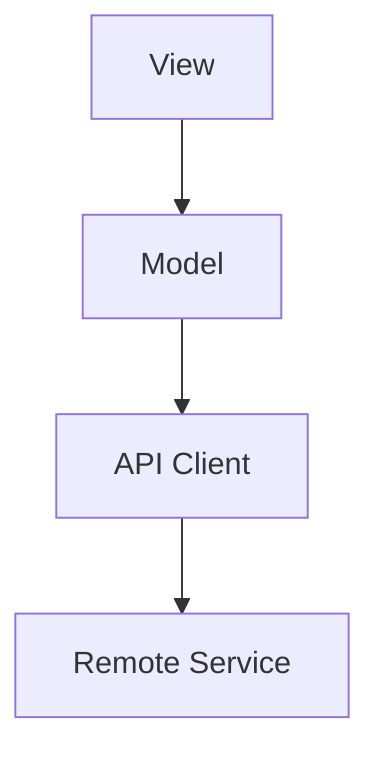

# Document Patterns

Use these patterns as examples of useful coverage when the task calls for a full document. They do not prescribe headings, section counts, or order. Follow required repository templates, preserve effective existing structures, and omit irrelevant sections. Use the document-design workflow when organization needs judgment.

## README

````markdown
# Name

One sentence describing what this project/package/tool does and who it is for.

## When to Use This

- Scenario where this is the right tool.
- Scenario where another tool would be worse.

## Non-Goals

- Work this project intentionally does not own.
- Adjacent concerns delegated elsewhere.

## Requirements

| Requirement | Version | Notes |
|-------------|---------|-------|
| Build tool  | Verified version | Replace with the project's actual requirement. |

## Getting Started

1. Install prerequisites.
2. Run the setup command.
3. Run the verification command.

```sh
make bootstrap
make test
```

## Core Concepts

Define the smallest set of concepts needed to use or modify the project.

## Common Tasks

### Task Name

Place necessary conditions before the action they govern. Show interpretable code or commands with the context the task needs.

## Configuration

| Setting | Required | Default | Description |
|---------|:--------:|---------|-------------|
|         |          |         |             |

## Testing

Explain which tests to run for common changes.

## Troubleshooting

| Symptom | Likely cause | Fix |
|---------|--------------|-----|
|         |              |     |

## Trade-Offs and Constraints

Name limits, failure modes, and intentionally unsupported cases.
````

## ADR

````markdown
# Decision Title

Status: Proposed | Accepted | Superseded
Date: YYYY-MM-DD
Deciders: Team or names, if the project tracks them
Supersedes: Link, if applicable
Superseded by: Link, if applicable

## Context

Describe the forces that make a decision necessary: technical limits, product needs, team constraints, platform behavior, cost, reliability, migration pressure, or deadline.

Frame the central question when useful:

> How can we [achieve outcome] while [preserving constraint]?

## Decision Drivers

- Driver that matters to correctness or maintenance.
- Driver that matters to migration or operations.
- Driver that matters to user or developer experience.

## Considered Options

| Option | Benefits | Costs | Notes |
|--------|----------|-------|-------|
|        |          |       |       |

## Decision

We chose [option], because [reason tied directly to the drivers].

## Consequences

- Good: [benefit].
- Bad: [cost, risk, lock-in, operational burden, or migration cost].
- Neutral: [behavior future readers need to know].

## Follow-Up

- [ ] Work item that makes the decision safe.
- [ ] Measurement or validation needed after rollout.
````

## RFC or Proposal

Use this when the decision is not final or requires feedback.

````markdown
# Proposal Title

Status: Draft | In Review | Accepted | Rejected
Author:
Date:
Reviewers:

## Summary

One short paragraph describing the proposed change and its intended effect.

## Motivation

Describe the problem, who it affects, and why the current state is insufficient.

## Goals

- Observable outcome the proposal must achieve.

## Non-Goals

- Adjacent work intentionally excluded.

## Proposed Design

Explain the architecture, API shape, data flow, lifecycle, and integration points.

## Alternatives Considered

Explain serious alternatives and why they were rejected.

## Compatibility and Migration

Describe source compatibility, runtime compatibility, data migration, rollout, and rollback.

## Observability and Verification

Define logs, metrics, tests, dashboards, or manual checks that prove the change works.

## Risks

| Risk | Impact | Mitigation |
|------|--------|------------|
|      |        |            |

## Open Questions

- [ ] Question that must be answered before implementation.
````

## Design Doc

````markdown
# Design Title

## Problem

State the problem in operational or developer terms. Avoid solution language here.

## Constraints

List platform, compatibility, performance, privacy, data, deployment, team, or deadline constraints.

## Architecture

Describe components and responsibilities. Include a diagram if relationships are hard to see in prose.

## Data Model

Define important entities, ownership, persistence, validation, and lifecycle.

## Control Flow

Describe request, event, or state transitions in order.

## Failure Modes

| Failure | Detection | Behavior | Recovery |
|---------|-----------|----------|----------|
|         |           |          |          |

## Testing Strategy

Map important behavior to unit, integration, UI, snapshot, property, load, or manual tests.

## Rollout

Explain flags, staged release, migration, rollback, and monitoring.
````

## Runbook

Use runbooks for operational procedures that someone may execute under stress.

````markdown
# Runbook: Incident or Task Name

## Purpose

What this runbook fixes or operates.

## Impact

User-visible or system-visible impact.

## Preconditions

Access, tools, environment, and safety checks.

## Diagnosis

1. Check signal.
2. Interpret result.
3. Decide branch.

## Mitigation

Numbered steps with commands and expected output.

## Rollback

Steps to return to the previous safe state.

## Verification

Signals that prove the system recovered.

## Escalation

Who or what system owns follow-up.
````

## Migration Guide

````markdown
# Migrating from Old System to New System

## Summary

State who needs to migrate and why.

## Compatibility

Name supported versions, unsupported versions, and behavior during the transition.

## Before You Start

Prerequisites, backups, flags, branch state, and expected time or risk.

## Step 1: Change the Call Site

```swift
// Before

// After
```

Explain why the change is required.

## Verification

Commands, tests, logs, or UI checks.

## Rollback

How to undo the migration if verification fails.

## Known Issues

List incomplete cases and workarounds.
````

## Troubleshooting Guide

````markdown
# Troubleshooting Topic

## Symptoms

- Observable symptom.
- Error message.

## Quick Checks

```sh
command-that-does-not-change-state
```

## Causes and Fixes

| Symptom | Cause | Fix | Verification |
|---------|-------|-----|--------------|
|         |       |     |              |

## Escalation

When to stop debugging and involve an owner.
````

## API Reference

````markdown
# Symbol or Endpoint Name

One sentence explaining the purpose.

## Signature

```swift
func loadImage(for request: ImageRequest) async throws -> ImageResponse
```

## Parameters

| Name | Description |
|------|-------------|
|      |             |

## Returns

Describe the successful result and ownership/lifecycle semantics.

## Errors

Describe error categories, not every implementation detail.

## Concurrency and Side Effects

State actor/thread requirements, cancellation behavior, ordering, persistence, network, filesystem, or privacy effects.

## Example

Use a realistic example that could compile or run with minimal surrounding context.
````

## PR Description

````markdown
## Summary

- Change that matters to reviewers.
- Change that affects behavior, compatibility, or risk.

## Test Plan

- [ ] Command or manual check with result.
- [ ] Platform/device coverage when relevant.

## Risk

State migration risk, rollout risk, or why risk is low.
````

## Release Notes or Changelog Entry

Write from the reader’s perspective. Group entries by impact.

````markdown
## Breaking Changes

- Changed [behavior]. Existing clients must [migration].

## Added

- Added [capability] for [use case].

## Fixed

- Fixed [bug] that caused [observable impact].

## Migration Notes

- Replace [old pattern] with [new pattern].
````

## Diagrams

Use a diagram when relationships are easier to inspect visually than in prose. Keep labels short and define unusual terms after the diagram.


